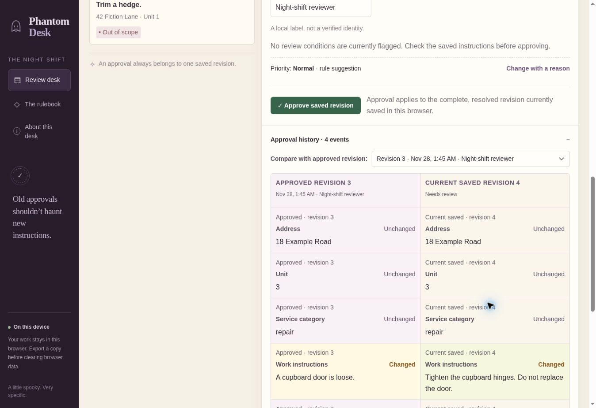

# PhantomDesk — the broken approval seal

A browser-local maintenance review desk where approval belongs to an exact saved revision. Change the instructions, break the seal. The old approval stays in history, and the changed request needs review before it can enter the work-list export again.

## Current state — November 28, 2026

The published prototype implements the approval workflow and a selectable approval inspector in buildless HTML, CSS and JavaScript modules with IndexedDB persistence. **42 Node domain tests and nine actual-browser IndexedDB checks passed.** A separate browser walkthrough verified the inspector, a real CSV download, stale-download rejection, later duplicate relationships and cross-tab updates that preserve an unsaved draft. See [BUILD-STATUS.md](docs/BUILD-STATUS.md) for the exact scope and evidence.

**Development attribution:** Codex authored the original working prototype. Kiro CLI made a substantive November 28 contribution: the comparison helper, historical selector, comparison renderer and styles, and eight additional domain tests. Independent Codex review then corrected condition comparisons, selection stability, draft refresh and status labels. [The Kiro development record](docs/KIRO-USAGE.md) preserves that distinction and the observed execution evidence.

The revised [public app](https://phantomdesk.neighborlyhydrangea16.chatgpt.site/) is live as version 3, deployed on November 28 and checked in the actual public page. Runtime source and supporting evidence are published and verified at [commit `7801ab90`](https://github.com/admas-ai/phantomdesk/commit/7801ab90ab5edeb060f226e4e7fa148b1b49fa25). The [1:54 narrated demonstration](https://www.youtube.com/watch?v=raMvzOlu98o) is published publicly on YouTube. The release-status documentation was updated after that source checkpoint; Devpost sign-in succeeded; CAPTCHA verification and submission remain pending. See [the release record](docs/evidence/release-2026-11-28.json) for the exact publication checks and their limits.

## Run locally

Use a recent browser with JavaScript and IndexedDB enabled. The app has no package dependencies, backend or runtime AI service. Serve the repository over HTTP; opening `index.html` directly as a file is not the supported workflow.

From the repository root, with Python installed:

```bash
python -m http.server 8000
```

Open [http://localhost:8000](http://localhost:8000). This starts a local development server.

For the domain tests, use Node.js 20 or newer:

```bash
node --test
```

For the actual-browser storage checks, open [http://localhost:8000/tests/browser.html](http://localhost:8000/tests/browser.html) and choose **Run browser checks**. Each check uses a unique disposable test database. The test page never opens the application's database. Its results cover repository and IndexedDB behavior; the separate UI observations are recorded in [the November 28 interface report](docs/evidence/ui-checks-2026-11-28.json).

## Try the workflow

1. Open **Synthetic demo** for five made-up maintenance examples, or **Your workspace** for a separate empty ledger.
2. Complete missing details and inspect the transparent sample rules. Possible duplicates remain separate records.
3. Resolve each review condition with a reason. A priority override also needs a reason.
4. Approve the current saved revision. Its exact field and review snapshots remain in history.
5. Open **Export approved**, then edit and save an approved request. The seal breaks. Attempting to download from the old preview is blocked.
6. Use **Compare with approved revision** to select a current or preserved approval. The inspector compares it with the current saved record using visible Changed/Unchanged labels, separate condition details and recorded review reasons. Selecting history does not approve or change a request.
7. Review and approve the new revision, refresh the preview, and download the CSV. The file includes the approved instructions, request ID, revision and approval time.

An unsaved editor draft is explicitly identified and stays separate from the saved comparison. If another tab saves a newer revision, the inspector updates while the draft keeps its original base revision; a stale save is rejected.

A newly matching request can also invalidate an existing approval. Duplicate decisions are scoped to the particular pair and matching key; resolving one pair does not resolve a later third request. Changes to affected records and their histories commit together.



The haunted night-shift records office is intended for the **Costume Contest** category. The seal and revision comparison explain an actual approval boundary. The screenshot is from the November 28 synthetic walkthrough; the checked runtime is now deployed publicly.

## Scope and limitations

Records stay in this browser on this device. There are no accounts, shared workspaces or server backups. Clearing site data can remove records. Reviewer names are descriptive labels, not authenticated identities, and the history is not protected against a device owner modifying browser storage.

The app does not assign or dispatch work, send messages, automatically merge possible duplicates, or automatically approve a request. The possible-leak flag is a sample review rule, not an emergency assessment. General JSON import is deferred and has no placeholder control.

The observed 360px embedded layout and native keyboard selector checks do not establish full accessibility coverage or physical-device compatibility. Actual 200% browser zoom, broader keyboard/dialog coverage and an injected storage-failure path in the UI remain unverified.

## Development and evidence

| Location | Contents |
| --- | --- |
| `domain/requests.js` | Pure validation, deterministic conditions, versioned decisions, approval comparison and CSV eligibility |
| `storage/repository.js` | Atomic IndexedDB persistence, revision conflicts and workspace isolation |
| `ui/app.js`, `index.html`, `styles.css` | Review desk, editor, selectable approval history and export interface |
| `fixtures/requests.json` | Five wholly synthetic maintenance examples |
| `tests/domain.test.js` | Executable Node domain tests |
| `tests/browser.html`, `tests/browser.js` | Executable real-browser IndexedDB checks |
| [BUILD-STATUS.md](docs/BUILD-STATUS.md) | Observed results, evidence and publication status |
| [KIRO-USAGE.md](docs/KIRO-USAGE.md) | Codex/Kiro attribution and genuine Kiro execution record |
| [November 28 storage report](docs/evidence/browser-checks-2026-11-28.json) | Nine checks passed in real IndexedDB |
| [November 28 interface report](docs/evidence/ui-checks-2026-11-28.json) | Actual browser observations and their limits |
| [Downloaded CSV](docs/evidence/approved-revision-2026-11-28.csv) | Inspected synthetic export for approved revision 5 |
| [Release record](docs/evidence/release-2026-11-28.json) | Verified deployment, source and YouTube publication checkpoints |
| [SUBMISSION-DRAFT.md](docs/SUBMISSION-DRAFT.md) | Unsubmitted project description and pending fields |

The root `.kiro/` directory contains the preserved requirements, specification, steering and task inputs. Their presence alone is not evidence of Kiro execution; the [sanitized contribution record](docs/evidence/kiro-contribution-2026-11-28.json) records the actual run. The [acceptance matrix](acceptance-checks.json) distinguishes passed, partial, unverified and deferred cases.

## Publication and submission

- **Public demo:** [PhantomDesk](https://phantomdesk.neighborlyhydrangea16.chatgpt.site/) — version 3 deployed successfully at `2026-11-28T07:17:00.225188Z`. The public page loaded five fixtures; missing-unit blocking, save/approval and the new selector were verified.
- **Public source:** [admas-ai/phantomdesk](https://github.com/admas-ai/phantomdesk) — runtime and supporting evidence verified at [`7801ab90`](https://github.com/admas-ai/phantomdesk/commit/7801ab90ab5edeb060f226e4e7fa148b1b49fa25); final release-status documentation was prepared after that checkpoint.
- **Genuine Kiro contribution:** completed source contribution, preserved and independently reviewed. Kiro's process was interrupted after a second provider cooldown; no normal final-completion response or Kiro-executed tests are claimed.
- **Demonstration:** [watch the public 1:54 walkthrough](https://www.youtube.com/watch?v=raMvzOlu98o) on Admas Academy. YouTube Studio confirmed publication and English subtitles. The [local media checks](docs/DEMO-PLAN.md) passed full decoding, 34 sampled-frame reviews and audio continuity checks. The cloud watch player remained buffering, so perceptual playback, signed-out playback and listening review are not claimed.
- **Devpost:** sign-in succeeded; a CAPTCHA appeared before draft creation. Verification and final entry completion remain pending; no submitted receipt is verified.

Publish the final release-status documentation, then complete the entry using the [official Kiroween rules](https://kiroween.devpost.com/rules). The technical evidence here does not itself establish contest eligibility or a submitted entry.

## License

MIT; see [LICENSE](LICENSE).
